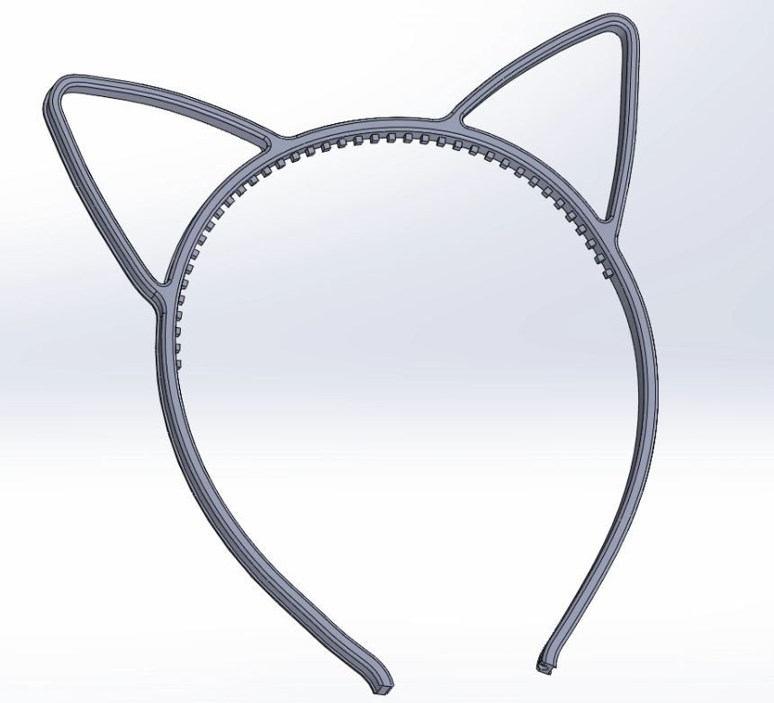

What started as simple 3D-printed catears I got at the CCC turned into multiple years of headaches. This is the story of four versions of my catears, and what I learned (the hard way) along the way.

<!--more-->

I guess this story begins at my first [Chaos Communication Congress](https://events.ccc.de/en/congress/) in 2023 ([37C3](https://events.ccc.de/congress/2023/infos/startpage.html)).

For those who have never been, the Congress is Europe's biggest hacker party, conference, and platform for technology, society, and civil liberties.
It's held yearly between Christmas and New Year. Each year, thousands of hackers, makers, artists, and volunteers take over a convention center for a few days to give talks, run workshops, build things together, and generally nerd out. Blinking lights, soldering irons, and DIY contraptions are everywhere!

It was the first time I went to an event of the sort, and it was astonishing! Between the talks, the assemblies and the sheer amount of creativity on display. As I'm particularly shy, my first congress was spent mostly alone; I roamed around discovering the event. Since I'm a night owl and the congress is open 24/4, when things calmed down late at night/early morning, I met a few people, and it was quite nice!

I came back with a lot more ideas than I had left with. One of them, which I didn't see coming at all, was about cat ears.

 Fair warning: this article is a long story about a project that was supposed to be simple. It involves four versions, countless tiny LEDs, and more PCB respins than I'd like to admit. 

## Version 1 & 2 - The original and "Light-Up" version

As the congress went on, I started seeing more and more people wearing 3D-printed catears, which I thought was pretty cool! After searching a bit, I found that the appropriately named [C3CAT](https://c3cat.de/) assembly was distributing them.

This is from their website:
> The camp got some more people interested in the topic of printing cat ears and two of them pre-printed a lot before the 37c3. But even 1500 cat ears were sold-out in the first two days.

They also had a small stock of LED strips for the ["Light-Up"](https://wiki.hamburg.ccc.de/club:c3cat:start) version.
This version uses a 4mm 5V COB single-color LED strip, which made them even more awesome.
Unfortunately, I was too late to the party, and when I asked how I could get my hands on a pair with LEDs, I was told they didn't have enough stock remaining.

I told myself right then and there that I would have a light-up version ready for [38C3](https://events.ccc.de/congress/2024/infos/startpage.html).

## Version 3 - RGB!!!!

Still at the congress, I searched a bit online and found something even better: 5mm 5V COB strips with addressable LEDs!!!

I initially wanted to keep the 3mm COB strip, but after spending far too much time browsing AliExpress listings, the only thing I could find was 4mm non-addressable RGB.
And so I bought a 5m roll of the 5mm COB addressable kind 😅

When I got home, I started designing my own version. I didn't like the way the strip was held on the C3CAT version:
 - The LEDs didn't span the full band
 - The connection to the strip was too "loose" for me
 - I wanted a detachable connector

After a bit of time I had something I liked:

After waiting for the 3D print to finish, I attached the LED strip. Because the strip detached when the frame flexed, I ended up using CA glue to hold it in place.

For the controller I initially wanted something small, but I instead built a fully integrated box with a battery. For the ESP32 I settled on the [TinyPICO V3](https://unexpectedmaker.com/shop.html#!/TinyPICO/p/577111313) from Unexpected Maker and used a [PowerBoost 1000](https://www.adafruit.com/product/2465) from Adafruit to handle battery charging and the DC-DC for the LEDs.

This worked quite well, but it was very bulky:


images/v3/PXL_20261023_073557685.jpg "Front of the box"
images/v3/PXL_20261023_073608119.PORTRAIT.jpg "Back of the box"
images/v3/v3-5.jpg "Head band"
images/v3/v3-4.jpeg "Version without a battery for a friend"


Nevertheless, it was very cool, and when [38C3](https://events.ccc.de/congress/2024/infos/startpage.html) came, I got stopped quite a few times to talk about it. I think I was (one of) the first to have full RGB catears.

It turned out that the JST connector was quite fragile, and I ended up needing to go to the soldering corner to repair the cable! For the second build of this revision, I put some glue on the wires so that they wouldn't break.

> Note that while writing the article I noticed that C3CAT now has build instructions for [RGB catears](https://c3cat.de/rgb-ears-39c3.html) similar to mine. This would explain why I saw so many of them last year at 39C3. That said, their version only has the strip on the ears, not the full band.

## Version 4 - Moar RGB!!!!

Not to be outdone, I decided I needed more RGB and thought it would be very cool to have a 2D matrix on both ears and on each side of the catears to display animations/text. This turned out to be quite the challenge and took more than a year and a half of working on it on and off to get it how I wanted.

The idea was "simple":
  - Keep the band as-is
  - Custom PCB for the matrices
  - Since there is a PCB already there, put the ESP32 directly inside the ear

### Revision 1

The first revision was a simple ear-shaped matrix so that I could test the LEDs and figure out power requirements and WLED integration.

For the LEDs I choose the [XL-1010RGBC-WS2812B](https://www.digikey.fr/fr/products/detail/xinglight/XL-1010RGBC-WS2812B/25672944). Those little critters are a traditional WS2812B LED squeezed into a 1mm * 1mm * 1mm package, and they are just as bright (if not more).

This raised two concerns:
 - **Heat**. The board is rather small and has a bunch of LEDs. Even when they are off, the microcontroller inside every LED still pulls 0.35mA, which at scale heats up the board. When the LEDs are on, it's even worse: I have seen this board reach 70/80°C, which is technically in spec but definitely not ideal.
 - **Power**. According to the datasheet, each LED pulls 5mA. Multiply that by 300, and it's 1.5 amps per panel. For the final product, that's roughly 6.5 amps once you factor in the controller and headband.

But I ordered a test board anyway to see if it was even possible to do 🤔.


images/v4-rev1/v4.1.jpg "Simple PCB placed on a dummy 3D print"
images/v4-rev1/v4.1-3.mp4.gif "First WLED integration"


It also proved that they are bright enough that there isn't really a need to push the brightness past 20%; otherwise, you get blinded pretty fast. You can see in the GIF that the first panel in the GIF above is overloading the camera!

But it also showed a viable concept. 🎉

### Revision 2

For this revision, I took the issues I saw before and did mostly nothing to solve them 🤡. I instead focused on integrating the ESP32 and power on the other side.

My original worry was that I might be pushing too many amps over a USB cable and that voltage would drop to unacceptable levels. To solve this, I thought that USB-PD would be a good fit. The idea was to request 12V from a battery pack and regulate it down to 5V on each panel.
I selected the following ICs:
 - The [HUSB238](https://en.hynetek.com/2421.html), a `highly integrated USB Power Delivery (PD) controller as sink role for up to 100W power rating`. It was also the easiest/fastest IC I could get my hands on.
 - The [TPS65320D](https://www.ti.com/product/TPS65320D-Q1), a `3.6V to 36V, 3.2A buck converter with auto-sourced 280mA LDO regulator`

The cool thing about the TPS65320D is that it integrates the DC-DC and the LDO in a single chip, which is pretty nice considering the space constraints. It was supposed to provide around 3 amps on the main output and 200mA for the 3.3V with over-current and over-temperature protection.

For the controller I used an ESP32-S3 running WLED. I chose it mainly because it integrates USB directly, which removes the need for a secondary USB-UART chip. When I started this project, support for the S3 variant was just coming out, but it worked just fine in the end.

The first board used a 2-layer PCB to reduce cost; in hindsight, this was a rookie mistake that cost me a revision. 🤦


images/v4-rev2-0/v4.2-2.jpg "PCB Front side"
images/v4-rev2-0/v4.2-3.jpg "Assembled prototype"
images/v4-rev2-0/PXL_20250811_194241836.mp4.gif "Powerup over USB-PD"


It worked, but being a 2-layer board, it came with a few issues:
  - Routing was a nightmare: no proper ground return path and thin traces.
  - No heat dissipation, which amplified the heat issue.
  - WiFi sucked because it was not tuned properly and was using a very small antenna.
  - I messed up the microphone footprint, so I had to use some bodge wires.

#### Revision 2.1

I then decided to redo it as a 4-layer PCB with mostly the same components. Since I didn't have to route everything on the top layer, I got a bit more room to play with and added pads for mounting it to the frame using the [74663025R](https://www.digikey.fr/fr/products/detail/w%C3%BCrth-elektronik/74663025R/14113581) from Würth (my plan was to sand them down to make it fit).


images/v4-rev2-1/Moonlight_2026_10_22_13-47-37_DZIkAg8EmJ.png "PCB back-side render"
images/v4-rev2-1/Moonlight_2026_10_22_13-48-08_Hy56Djusej.png "PCB front-side render"


As you can see, even with 4 layers, it's very crowded; routing was better but still complicated.

But it powered up just fine:


images/v4-rev2-1/PXL_20251020_085448310.RAW-01.COVER.jpg "LED bring-up using external controller"
images/v4-rev2-1/PXL_20251020_200442918.RAW-01.COVER.jpg "Front side"
images/v4-rev2-1/PXL_20251020_200450275.RAW-01.COVER.jpg "Back side"
images/v4-rev2-1/PXL_20251021_224410519.mp4.gif "Power consumption tests"
images/v4-rev2-1/PXL_20251022_224244033.mp4.gif "Power consumption tests"


Unfortunately, as I already semi-expected, things didn't improve a lot:
  - It still overheated.
  - WiFi still sucked, but this time it was my fault for not using the proper values for the tuning network.
  - I broke the mic while soldering by pouring flux down its hole, so no sound-reactive animations.

**And that's when I figured out that I over-built the damn thing.** 
Realistically, the USB-PD and a buck converter on each panel caused more issues than they solved:
 - It takes a bunch of space on the PCB
 - Produces a bunch of heat

#### Revision 2.2

Modern USB-C cables are designed to handle high loads, even at 5V. Since the max amperage is only used at full brightness (which I can't use either because it overheats or because I blind people), there wasn't really a need to handle high currents.

So I decided to de-solder the DC-DC converter, add an LDO for the 3.3V, add a 5.1k resistor for the CC line, and solder the cable directly to 5V.

The version that made it to [39C3](https://events.ccc.de/congress/2025/infos/startpage.html) was the same PCB but with power regulation bypassed. This improved stuff quite a bit; at least the ESP32 didn't lock up randomly, though WiFi was still terrible.


images/v4-rev2-2/PXL_20251030_012930127.RAW-01.COVER.jpg "Bodged DC-DC bypass"
images/39c3/PXL_20251230_131957410.RAW-01.COVER~2.jpg "V3 + V4 in front"
images/39c3/PXL_20251230_131923306.RAW-01.COVER.jpg "V3 + V4 in front"


> 39C3 was awesome, and it was also my first congress as an Angel. 
> Angels are the volunteers who keep the whole event running. I signed up to help with the video side of things, and ended up doing a bit of everything there, including simpler stuff like line control or evacuation. It meant I saw a lot more of the congress from behind the scenes, and I loved it.  
> Being an Angel also made it much easier to meet people. I got to know a bunch of very cool new folks while working shifts together, and I also got to catch up with a few people I had met at 37C3 and 38C3.

### Revision 3 - Taking things out

Lessons learned: for revision 3 I removed things:
  - The USB-PD and DC-DC are gone. It's now powered directly by 5V, and the 3.3V needed for the ESP32 is derived by a [MPM3805](https://www.monolithicpower.com/en/mpm3805.html) (a small step-down converter with integrated inductor).
  - WiFi works wonders. I replaced the ceramic antenna with an [IRD-C013](https://www.digikey.com/en/products/detail/joymax-electronics/IRD-C013SMDB/26742123) and the proper tuning CLC network for the 4-layer PCB.
  - The boards now live in an SLS-printed PA12 frame, held in place with CA glue and silicone. Silicone doesn't stick well to FR4 and solder mask, which is precisely what I want: it's held in place, but the board can still be removed and repaired.

Because you can't have a design work the first time around, I still ran into an issue. The WS2812 LEDs are 5V, and typically you would use a 5V signal or a level shifter, but because it always worked before, I didn't 🤦.

The MPM3805 that powers the ESP32 is wonderful, but it gives 3.3V **exactly** (as it should), and for some reason it turns out that the drive strength of GPIO38 (the output that drives the main panel) is somehow weaker, which led to data corruption and, in turn, visual glitches. Any other GPIOs worked just fine, but I wasn't about to reorder expensive PCBs just to change a pin!

I did a bunch of testing, and it turns out that slightly raising the 3.3V line resolved all issues. To make sure it won't happen randomly on another output, I chose to increase the supply voltage instead of changing the pin. It was actually straightforward to do; the MPM3805 has an `OUT_S` pin that the datasheet tells you to connect to `OUT`. This pin is the supply for the resistor divider used for the DC-DC feedback loop. There isn't any formula in the datasheet that tells you how it works, but I found that using a 3.3k resistor raised the supply to 3.47V, just enough to stay in the ESP32 spec and avoid glitches. 🥳

That said, it's undocumented and might be different from chip to chip 🤔, so use this at your own risk.

Because the LED matrix is designed to be horizontal when the ears are worn, the PCB itself is angled by a few degrees. This also means that in order to keep continuity between the left ear and the right ear, I needed to make two PCBs. It's actually pretty convenient because the second PCB can act as a "cable organizer/router" so that there isn't a mess of cables.

The 3D-printed band also got a redesign to remove unwanted features from the previous version and to add hidden cable passes inside the band.

You can also see that for the first time the LEDs are somewhat aligned to a grid; previously, I just crammed in as many as possible. This version has slightly fewer LEDs, which reduces cost, power, and heat, but it's just as bright and makes routing easier. I also scripted part of the layout in KiCad 9's Python console (mirroring footprints, routing the LED data chain) instead of clicking through each pad by hand.


images/v4-rev3/pcb/a_back.png "Side A back side (ESP32-S3)"
images/v4-rev3/pcb/a_front.png "Side A front side (led matrix)"
images/v4-rev3/pcb/b_back.png "Side B back side (Cable routing)"
images/v4-rev3/pcb/b_front.png "Side B front side (led matrix)"
images/v4-rev3/cad/render.webp "Band"


### Assembly

This was by far the trickiest bit; there's a lot of stuff that needs to interconnect and work perfectly!

#### USB Cable

The first step was finding a USB-C cable that I liked. I chose a 2m cable with a flexible silicone outer sheath, bought from [Amazon](https://www.amazon.fr/dp/B0DG2GLMPQ).


images/v4-rev3/PXL_20260728_172841944.jpg "Stripped cable"
images/v4-rev3/PXL_20260728_173609275.jpg "Individual wires passed through the 1st cable pass"
images/v4-rev3/PXL_20260728_173612233.jpg "Individual wires fully passed through the inside"


It ended up fitting perfectly; the 3 data wires are pretty thin, and the grounding isn't isolated. With some fiddling, it was possible to pass everything through the tiny cable passes.

#### Left side front PCB

As explained before, the left PCB acts as an organizer to make routing easier.

You can see how it works in the images below: 5 conductors of very thin multi-strand wire go from the right side to the left side in the middle cable pass. The signal gets distributed, and another 3-conductor cable leaves for the outer band.


images/v4-rev3/PXL_20260728_165810814.jpg "Bare PCB"
images/v4-rev3/PXL_20260728_171752947.jpg "PCB placed in the headband with left-right link and band link soldered"
images/v4-rev3/PXL_20260729_202442676.jpg "PCB placed in the headband with left-right link and band link soldered"


#### Right side front PCB

The "main" right PCB is basically the same; the wire comes in, this time from USB-C, and the central wire goes out.

This step was also the first power-up test with a fully integrated PCB in the frame. 🤩


images/v4-rev3/PXL_20260729_201139439.jpg "Left-right link soldered"
images/v4-rev3/PXL_20260729_202405005.jpg "USB-C Cable soldered"
images/v4-rev3/PXL_20260729_202426172.jpg "Mid-assembly powerup test"


#### Backside PCBs

For the back PCBs, instead of making another two variants, I simply reused the front ones and added some Kapton tape to make sure nothing shorts out.

This actually fits pretty well because with JLCPCB the minimum order count for an assembled PCB is two, and since I only assembled the LED side, it was a nice way to save some money 💸.


images/v4-rev3/PXL_20260729_210228934.jpg "Back left PCB"
images/v4-rev3/PXL_20260729_213350364.jpg "Back right PCB during testing"
images/v4-rev3/PXL_20260729_214947129.jpg "Back right PCB after assembly"


#### Band

After I confirmed that the panels themselves worked fully while inside the frame for multiple hours, I decided that I was confident enough to glue the cables and the outer band.

I unfortunately needed to glue the cables because there's just not enough space to put a cover. The outer band also needs to be glued because the included adhesive strip doesn't stick very well to PA12. The center between the ears is especially prone to bulging upwards when putting them on and wearing them for a long time.

> All revisions up to this point have the outer band glued, and I haven't seen it fail at all.


images/v4-rev3/rn_image_picker_lib_temp_23b7062a-bf4b-4440-88d7-25f1a826265c.webp "Super-glued lower right cable pass"
images/v4-rev3/PXL_20260729_221434427.jpg "Super-glued upper right cable pass"
images/v4-rev3/PXL_20260729_224533732.jpg "Start of gluing the strip"
images/v4-rev3/PXL_20260729_224539491.jpg "Middle of the strip gluing"
images/v4-rev3/PXL_20260729_224918814.jpg "End of the strip gluing"
images/v4-rev3/PXL_20260729_231015590.mp4.gif "Assembled test"


After this was done, I could see the first fully assembled test 🥳. The GIF above doesn't show it, but this is running an audio-reactive animation, and it's reacting to me snapping my fingers.

I can't tell you how happy I was after the fully assembled test; it looks spectacular 🤩!

#### Silicone

The last step is silicone. Since I removed the mounting holes in [revision 2.1](#revision-21), I need some way of holding the panels in place. The front panels are held with a tiny bit of superglue, just enough to hold them but not enough to be permanent.

The idea with silicone is to hold the PCBs in place while staying compliant enough when the frame flexes, and to protect the stupidly small and fragile XL1010s. And so I chose a platinum-cure silicone with a Shore 12A hardness, in other words, a very flexible silicone mainly used for casting, and a TODO pigment.

 Missing text & pictures 

## Conclusion

 Final HQ photos/video 

It has been a stupidly long road that started three years ago at 37C3, spanned three revisions, and took more than a year and a half of working on it on and off. As always, I learned a few things along the way, mostly the hard way 😅.

I'm happy with where they are: they're bright, they're small, and people keep asking about them. There's still room for improvement (real matrix instead of addressable, real screen, battery), but for the first time they do what I imagined when I started 😎.

Everything (schematics, PCB, 3D models, and firmware) is available on GitHub below, in case you want to build your own or improve on mine. If you do, I'd love to see it!

I will, of course, be wearing them at [40C3](https://events.ccc.de/congress/2026/infos/startpage.html); see you there!


