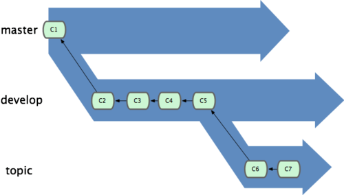
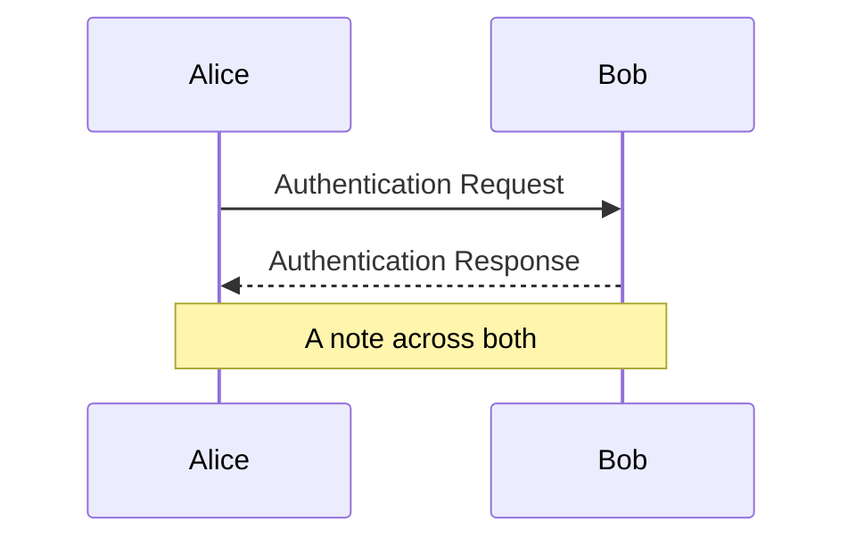
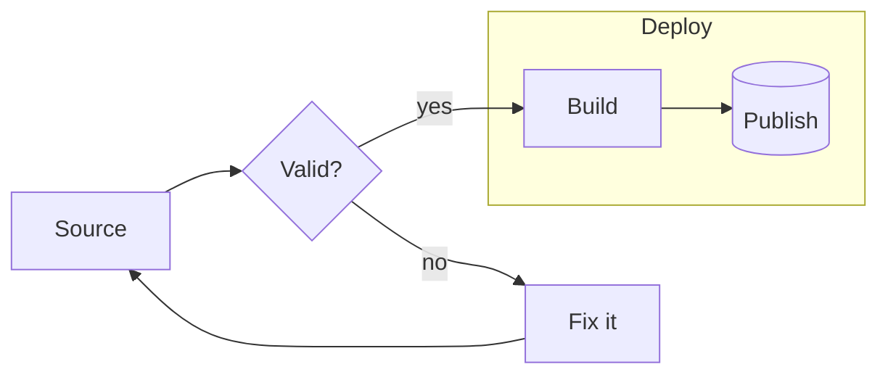
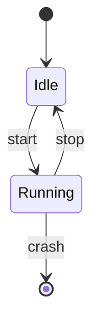

Lorem ipsum dolor sit amet, consectetur adipiscing elit, sed do eiusmod tempor 
incididunt ut labore et dolore magna aliqua. Pellentesque eu tincidunt tortor 
aliquam nulla facilisi cras fermentum odio. A erat nam at lectus urna duis. 
Sed velit dignissim sodales ut eu sem.

<!--more-->

Github Flavored Markdown (GFMD) is based on [Markdown Syntax Guide](http://daringfireball.net/projects/markdown/syntax) with some overwriting as described at [Github Flavored Markdown](http://github.github.com/github-flavored-markdown/)

## Text Writing
It is easy to write in GFMD. Just write simply like text and use the below simple "tagging" to mark the text and you are good to go!  

To specify a paragraph, leave 2 spaces at the end of the line

## Headings

```
# Sample H1
## Sample H2
### Sample H3
```

will produce
# Sample H1
## Sample H2
### Sample H3
#### Sample H4
##### Sample H5
###### Sample H6

---

## Horizontal Rules

Horizontal rule is created using `---` on a line by itself.

Test ==azerty== erggreg

---

## Coding - Block

<pre>
\`\`\`ruby
# The Greeter class
class Greeter
  def initialize(name)
    @name = name.capitalize
  end

  def salute
    puts "Hello #{@name}!"
  end
end

# Create a new object
g = Greeter.new("world")

# Output "Hello World!"
g.salute
\`\`\`
</pre>
 
will produce  

```ruby
# The Greeter class
class Greeter
  def initialize(name)
    @name = name.capitalize
  end

  def salute
    puts "Hello #{@name}!"
  end
end

# Create a new object
g = Greeter.new("world")

# Output "Hello World!"
g.salute
```

Note: You can specify the different syntax highlighting based on the coding language eg. ruby, sh (for shell), php, etc  
Note: You must leave a blank line before the `\`\`\``

## Coding - In-line
You can produce inline-code by using only one \` to enclose the code:

```
This is some code: `echo something`
```

will produce  

This is some code: `echo something`

---

## Text Formatting
**Bold Text** is done using `**Bold Text**`  
*Italic Text* is done using `*Italic Text*`

---

## Hyperlinks
- GFMD will automatically detect URL and convert them to links like this http://www.futureworkz.com
- To specify a link on a text, do this:

```
This is [an example](http://example.com/ "Title") inline link.
[This link](http://example.net/) has no title attribute.
```
This is [an example](http://example.com/ "Title") inline link.
[This link](http://example.net/) has no title attribute.

---

## Escape sequence
You can escape using \\ eg. \\\`

---

## Creating list

Adding a `-` will change it into a list:

```
- Item 1
- Item 2
- Item 3
```

will produce

- Item 1
- Item 2
- Item 3

---

## Quoting

You can create a quote using `>`:

```
> This is a quote
```

will produce

> This is a quote

## Table and Definition list

These two can only be created via HTML:

```html
<table>
  <tr>
    <th>ID</th><th>Name</th><th>Rank</th>
  </tr>
  <tr>
    <td>1</td><td>Tom Preston-Werner</td><td>Awesome</td>
  </tr>
  <tr>
    <td>2</td><td>Albert Einstein</td><td>Nearly as awesome</td>
  </tr>
</table>

<dl>
  <dt>Lower cost</dt>
  <dd>The new version of this product costs significantly less than the previous one!</dd>
  <dt>Easier to use</dt>
  <dd>We've changed the product so that it's much easier to use!</dd>
</dl>
```

will produce

<table>
  <tr>
    <th>ID</th><th>Name</th><th>Rank</th>
  </tr>
  <tr>
    <td>1</td><td>Tom Preston-Werner</td><td>Awesome</td>
  </tr>
  <tr>
    <td>2</td><td>Albert Einstein</td><td>Nearly as awesome</td>
  </tr>
</table>

<dl>
  <dt>Lower cost</dt>
  <dd>The new version of this product costs significantly less than the previous one!</dd>
  <dt>Easier to use</dt>
  <dd>We've changed the product so that it's much easier to use!</dd>
</dl>

| Syntax      | Description |
| ----------- | ----------- |
| Header      | Title       |
| Paragraph   | Text        |

## Adding Image

```

```


## Big Image


`#!php-inline $a = array("foo" => 0, "bar" => 1);`

## Definitions
Apple
:   Pomaceous fruit of plants of the genus Malus in 
    the family Rosaceae.

Orange
:   The fruit of an evergreen tree of the genus Citrus.

## Keyboard

<kbd>ctrl+alt+delete</kbd>

## Emojis

:smile: :heart: :thumbsup:

text with an emoji :thumbsup: lol

## Task List

- [X] item 1
    * [X] item A
    * [ ] item B
        more text
        + [x] item a
        + [ ] item b
        + [x] item c
    * [X] item C
- [ ] item 2
- [ ] item 3


## Diagrams (mermaid)







~~test~~

http://MP21A1.biotrialrennes.local:7898

Test: fefv https://www.youtube.com/watch?v=ytWz0qVvBZ0





































<hr>

images/1.webp
images/2.webp
images/3.webp
images/4.webp
images/5.webp
images/cover.jpg


---

# Theme visual tests

Everything below exists to eyeball the theme. Hover a heading to see its anchor icon.

## Figures

A figure **with** a caption (hover it: a long caption expands). Click to open the image viewer:


A figure with a **long** caption, which is cut with an ellipsis until hovered or focused:


A figure **without** a caption (no accent rule under it), directly followed by text on the next line:

This line comes right after the image, in the same paragraph.

## Galleries

Default (3 per row), 5 images so the last row is incomplete:


images/1.webp "First"
images/2.webp "Second"
images/3.webp "Third"
images/4.webp "Fourth"
images/5.webp "Fifth, with a longer caption to see how a caption behaves inside a gallery cell"


Two columns:


images/1.webp "One"
images/2.webp "Two"
images/3.webp "Three"
images/4.webp "Four"


Four columns, positional form:


images/1.webp "One"
images/2.webp "Two"
images/3.webp "Three"
images/4.webp "Four"
images/5.webp "Five"


One column, no captions:


images/1.webp
images/2.webp


Text directly after a gallery, to check the captions do not overlap it.

## Callouts

> A single line quote.

> A longer quote that wraps over several lines, to check the spine stretches and the text stays beside it. Lorem ipsum dolor sit amet, consectetur adipiscing elit, sed do eiusmod tempor incididunt ut labore et dolore magna aliqua.
>
> A second paragraph inside the same quote.


Details go here,
on several lines.


A warning with only a title and text.

A warning with no title at all.


- write the conclusion
- add a schematic


Term one
:   Its definition, on a single line.

Term two
:   A much longer definition that wraps over several lines to check how a definition list spine behaves when the text is taller than the minimum height of the block.

## Tables

| Reference | Name | Qty | Price |
| :-------- | :--: | --: | ----: |
| R1 | Resistor 10k | 12 | 0.01 |
| R2 | Resistor 4.7k | 3 | 0.01 |
| C1 | Capacitor 100nF | 40 | 0.02 |
| U1 | NE5532 dual op-amp | 2 | 0.85 |

## Code

With a title, line highlighting and numbers:

```python {title="main.py" hl_lines=[2,3]}
def hello(name):
    greeting = f"Hello, {name}"
    return greeting

print(hello("world"))
```

Without a title, a long line to check the horizontal scroll:

```bash
curl -fsSL https://example.com/a/very/long/url/that/keeps/going/and/going/and/going/and/going/and/going/and/going/install.sh | sudo bash -s -- --yes --verbose --prefix=/opt/example
```

Several languages:

```c
#include <stdio.h>

int main(void) {
    printf("Hello %d\n", 42); // a comment
    return 0;
}
```

```json
{ "name": "turtle", "tags": ["a", "b"], "enabled": true, "count": 3 }
```

Inline `code` next to <kbd>Ctrl</kbd> + <kbd>Shift</kbd> + <kbd>P</kbd> and ==highlighted text==.

## Lists

1. First
2. Second
   - nested bullet
   - another one
3. Third

- [x] done
- [ ] not done
    - [x] nested done
    - [ ] nested not done

## Embeds

An embed with `og` (opengraph fetching is disabled, so it is a plain card; YouTube links are always a player):



Text right after the embed, to check the spacing above and below it.



YouTube link variants (short link with a start time, a Short, an embed link):







## Buttons, icons






Inline icons:   

## Footnote and a long paragraph

A sentence with a footnote.[^1] Lorem ipsum dolor sit amet, consectetur adipiscing elit, sed do eiusmod tempor incididunt ut labore et dolore magna aliqua. Ut enim ad minim veniam, quis nostrud exercitation ullamco laboris nisi ut aliquip ex ea commodo consequat. Duis aute irure dolor in reprehenderit in voluptate velit esse cillum dolore eu fugiat nulla pariatur.

[^1]: The footnote text.

### A level 3 heading

#### A level 4 heading

##### A level 5 heading